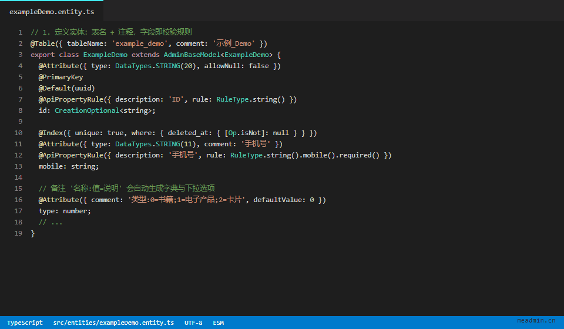
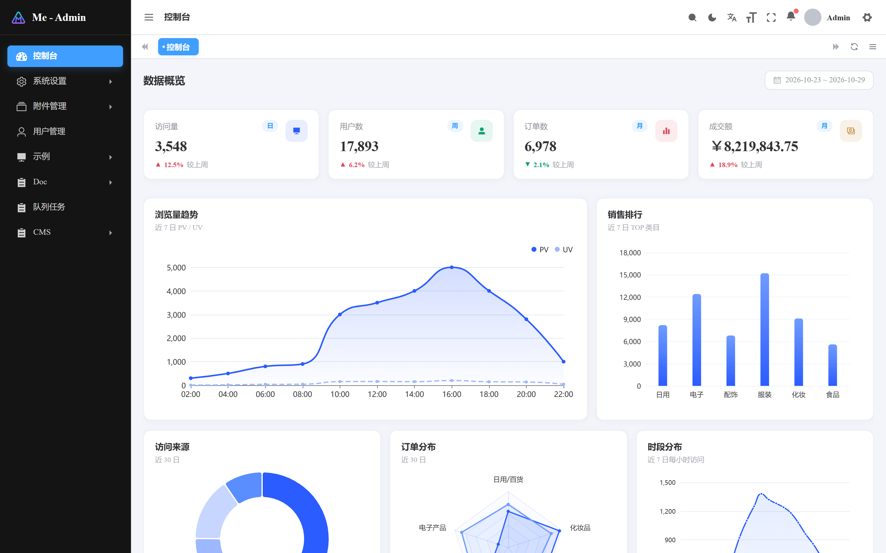
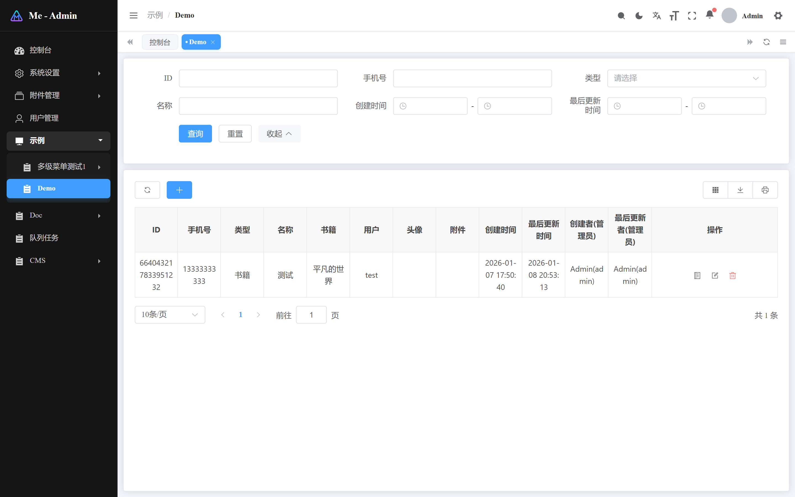
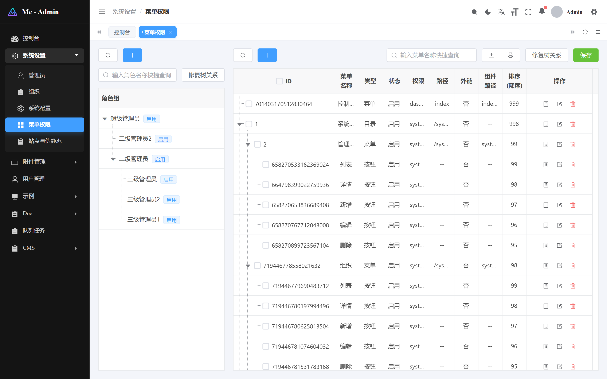

# Me-Admin

[](https://www.npmjs.com/package/@meadmin/cli)
[](LICENSE)
[](https://nodejs.org/)
[](https://github.com/meadmin-cn/meadmin/stargazers)

[English](README_EN.md) | [Simplified Chinese](README.md)

<p align="center">
  
</p>

<p align="center">
  
</p>
<p align="center">
  
  &nbsp;
  
</p>

**All-in-one full-stack admin solution** — Me-Admin is a free, open-source admin framework built on Node.js + Vue. The backend is based on Midway.js 3 and the frontend on Vue 3, with one-command CRUD, SSR and a full permission system out of the box. MIT licensed: no encryption, no license restrictions, free for commercial use.

- 🌐 Website: https://www.meadmin.cn
- 📖 Docs: https://www.meadmin.cn/aon/doc/
- 🐛 Issues: https://github.com/meadmin-cn/meadmin/issues

## Generate a business module in 30 seconds

Once your Sequelize entity is defined, two commands are all it takes:

```bash
# Sync the database schema
pnpm exec meadmin sync exampleDemo

# Generate controllers, API endpoints, frontend pages and menu permissions
pnpm exec meadmin crud exampleDemo --menu
```

> `meadmin` is the CLI entry provided by `@meadmin/cli`; always invoke it as `pnpm exec meadmin <command>`.

Refresh the admin panel — the menu is already there. List page, search, pagination, full CRUD, endpoints and menu permissions, all wired up. Everything is generated as readable, editable source code: no black boxes, no dead ends.

## Key Features

- **One-command CRUD**: generate controllers, models, views and menu permissions from the CLI — repetitive work goes to the framework
- **SSR + CSR hybrid rendering**: server-side rendering for the public site (better SEO and first paint), client-side rendering for the admin panel
- **Built-in RBAC**: menu / button / API three-level access control, unlimited nested groups, cross-group authorization; dynamic route permissions with button-level granularity; supports both frontend-driven and API-driven menu modes
- **Plugin architecture**: features are installable/uninstallable plugins — the ecosystem keeps growing while the core stays lean
- **Full TypeScript**: auto-generated TS types keep frontend-backend contracts in sync for free
- **On-demand component imports**: components under the `components` directory are imported on demand automatically, with customizable import locations and modes
- **Friendly i18n**: language packs are loaded asynchronously per component
- **Custom keepAlive**: key-based Vue keep-alive that solves cache pollution when different routes share one component
- **Configurable themes**: theme color and theme mode are both configurable
- **vxeTable integration**: the most feature-rich open-source Vue table component

## Tech Stack

| Layer | Technologies |
|---|---|
| Frontend | Vue 3 · Vite · TypeScript · Pinia · Element Plus · vue-request@next |
| Backend | Node.js · Midway.js 3.x · Sequelize 7 |
| Storage | PostgreSQL · Redis |

## Quick Start

### Requirements

- PostgreSQL
- Redis
- Node.js >= 22.14.0
- pnpm

### Create a project

```bash
pnpm create meadminjs@latest
```

Follow the prompts to configure your database and other options.

### Development

```bash
pnpm dev
```

- Admin panel: http://127.0.0.1:7001/admin
- Public site: http://127.0.0.1:7001/

### Production build

```bash
pnpm build
```

### Default accounts

**Admin panel**: `admin` / `meAdmin#202507!P`
**Public site**: `test` / `123456789`

## Support the project

If Me-Admin saves you time, please consider leaving a ⭐ [Star](https://github.com/meadmin-cn/meadmin/stargazers). Found a problem? Open an [Issue](https://github.com/meadmin-cn/meadmin/issues) — I answer all of them.

## Release Process

For framework maintainers. A release has two parts: **generating `meadmin.sql` plus the scaffold template**, and **publishing the npm packages**.

### Before releasing

- Prepare the env file for the reference database (for example `.env.local`) and make sure its `DATABASE_SCHEMA` is the schema used for the export
- Make sure the working tree is clean; follow Conventional Commits (`feat:` / `fix:` / `chore:`) — the CHANGELOG is generated by release-it

### Generate SQL and template

Run from the repository root and pick the environment with `-m` (`-m local` loads `.env` + `.env.local`, the latter overriding the former):

```bash
node packages/create-meadmin/bin/cli.js meadmin -m local
```

**The first step asks for the version number**: press Enter to keep the current one, or type a new one and it is written to `packages/{core,midway-vite-view,cli,create-meadmin}` plus the root `package.json` in one go. Only plain `x.y.z` is accepted (that is exactly what `meadmin update` requires, so it fails early instead of after publishing). Non-interactive runs (CI, pipes) do not block — pass `--release-version 1.3.17` instead.

The remaining steps run in order and abort without writing partial output if any of them fails:

1. Load the database config (`-m` expands to `.env` + `.env.<env>`; blank values count as unset)
2. Analyse addon assets (read-only): tables prefixed `aon_`, the `addons_` root menu plus descendants, and site/rewrite bindings pointing at `/aon/<addon>`
3. Produce a clean `meadmin.sql` (addons removed, menu nested set recalculated from `parent_id`)
4. Validate the menu tree (unique left/right bounds, children inside the parent range)
5. Write a full backup including addon tables (for rollback only)
6. Import into a temporary schema to verify table structure, row counts and menu relations, then drop it
7. Write the files, then generate the template

Outputs:

| Path | Content |
|---|---|
| `meadmin.sql` | Clean core data, no schema prefix, no addon content |
| `.workbuddy/release/backup-<timestamp>.sql` | Full database backup |
| `.workbuddy/release/meadmin-<timestamp>.prev.sql` | Previous `meadmin.sql` |
| `packages/create-meadmin/template/meadmin/` | Scaffold template |

Useful options: `-m, --mode <env>` (load `.env` + `.env.<env>`, e.g. `-m local`), `--release-version <x.y.z>` (skip the version prompt), `--env <file>` (explicit config file, wins over `-m`), `--schema <name>`, `--only-template` (skip the export and rebuild the template from the existing `meadmin.sql`), `--skip-template`, `--keep-addon <name...>`, `--skip-backup`, `--skip-verify`, `--dry-run`.

If only frontend/template code changed and the database did not, `--only-template` is enough.

### Build and publish

```bash
pnpm -F @meadmin/core build
pnpm -F @meadmin/midway-vite-view build
pnpm -F @meadmin/cli build
pnpm -F create-meadminjs build
```

Publish in dependency order from each package directory with `pnpm publish` (scoped `@meadmin/*` packages need `--access public`): `core` → `midway-vite-view` → `cli` → `create-meadmin`.

`release-it` only handles the version commit, tag, GitHub Release and CHANGELOG — it does **not** publish to npm (`.release-it.json` sets `npm.publish: false`):

```bash
pnpm release
```

### Post-release checks

- Create a fresh project with `pnpm create meadminjs@latest` and confirm it initialises and `pnpm dev` starts
- Rehearse the upgrade path: publish a pre-release to a local verdaccio, then run `pnpm exec meadmin update` in a test project and confirm `update.sql` is generated and both the schema sync and the tree repair succeed

### Notes

- `meadmin.sql` must stay clean core data. Addon tables, addon menus and addon site bindings are stripped automatically — do not bypass that logic
- The export must not contain `SET` statements, and backslash literals must use `E'...'`, otherwise `update` treats the SQL as unsafe and skips it
- Re-export `meadmin.sql` even when there is no schema change: `update` relies on it entirely for data upgrades
